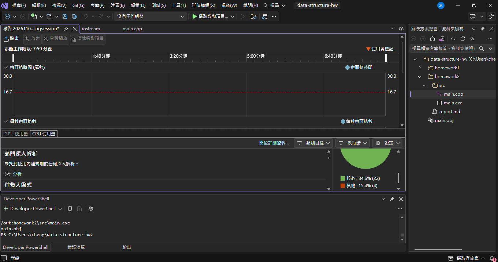

# 41443114
- 姓名：李承穎
- 科系：資工二甲

## 一、解題說明

本次作業主要完成兩個部分：
1. 按照投影片中的 Figure 1 與 Figure 2，使用 C++ 實作多項式類別 `Polynomial`，底層利用 `Term *termArray` 動態陣列只存非0項，並完成建構子、加法 `Add`、乘法 `Mult` 與求值 `Eval`
2. 多載輸入 `>>` 與輸出 `<<` 運算子，使多項式能直接配合 `cin` 與 `cout` 操作

### 1. 課本比較：為什麼範圍過大不能用一般陣列？
在想多項式的表示方式時，會直覺會想用 `float coef[1000]`，直接以陣列索引（index）對應次方裡面填係數。但觀看課本第 2 章 2-3.1 節，這種方式在遇到高次方就會有缺點：
* **課本表示法 1（固定大小陣列）**：必須事先寫死最大次方 `MaxDegree`。設太小遇到高次方會溢位，設太大平時會浪費絕大多數記憶體空間
* **課本表示法 2（依最高次方動態配置）**：雖然空間是依最高次動態決定，但課本舉了稀疏多項式的例子，例如 a(x) = 2x^{1000} + 1，這個多項式明明只有 2 個非0項，卻因為最高次是 1000，必須開出長度 1001 的陣列，中間塞了整整 999 個 0，耗費 1002 個單位空間，做運算時迴圈還要白跑 999 次去處理這些0
* **課本表示法 3（Figure 2 採用的方式）**：定義 `Term` 類別只存 `(coef係數, exp次方)`，在 `Polynomial` 中使用動態指標 `Term *termArray` 專門存放非0項，同樣存 2x^{1000} + 1，表示總共只需要 6 個單位空間（`capacity`、`terms`、2 個係數、2 個次方），當空間不足時，再透過 `NewTerm` 將容量倍增（`capacity *= 2`），很好的兼顧了彈性與記憶體節省

### 2. 實作過程中排除的 Bug 與除錯記錄
在實際做與測試過程中，我抓出了幾個一開始未考慮到的邏輯與記憶體 Bug：

* **Bug 1：傳值呼叫引發的指標重複的釋放**
  剛寫完解構子 `delete[] termArray` 時，一執行 `a.Add(b)` 程式就當掉，追蹤後發現 Figure 1 規定的參數是傳值 `Polynomial poly` 而非傳參考，C++ 預設的淺Copy只複製指標位址，導致函式內的區域變數與外部物件指向同一塊記憶體；函式結束時區域變數被消滅並執行 `delete[]`，連帶把外部物件的陣列也釋放了，為此我補上了深Copy建構子與指派運算子 `operator=`，為每個物件配置獨立記憶體空間後解決。
* **Bug 2：項數全部抵消時 `terms` 變為負數的越界崩潰**
  在 `NewTerm` 檢查同次方相加抵消時，我原先寫 `if (termArray[i].coef == 0) terms--;`，但當多項式原本只有 1 項且剛好被抵消為 0 時，`terms` 被減成 `-1`，導致後續程式去讀取 `termArray[-1]` 造成記憶體存取錯誤，修正時加入了 `if (terms < 0) terms = 0;` 確保項數不小於0。
* **Bug 3：輸入沒有依照降冪或重複次方的排序錯亂**
  課本的 `Add` 是以雙指標依序推進，完全依賴內部陣列「已照降冪排好」的前提，如果使用者輸入時先輸入低次方再輸入高次方，雙指標演算法就會算出錯誤結果，因此我在 `>>` 讀入時加入了氣泡排序，確保所有項目在進入運算前皆按降冪排整齊。

---

## 二、程式實作

僅使用 <iostream>、<algorithm>、<cmath> 標頭檔完成的程式碼：

```cpp
#include <iostream>
#include <algorithm>
#include <cmath>
using namespace std;

class Polynomial;

class Term {
    friend class Polynomial;
    friend ostream& operator<<(ostream& os, const Polynomial& p);
    friend istream& operator>>(istream& is, Polynomial& p);
private:
    float coef;
    int exp;
};

class Polynomial {
public:
    Polynomial();
    Polynomial(const Polynomial& p);
    ~Polynomial();
    Polynomial& operator=(const Polynomial& p);

    Polynomial Add(Polynomial poly);
    Polynomial Mult(Polynomial poly);
    float Eval(float f);

    void NewTerm(const float theCoeff, const int theExp);

    friend ostream& operator<<(ostream& os, const Polynomial& p);
    friend istream& operator>>(istream& is, Polynomial& p);

private:
    Term *termArray;
    int capacity;
    int terms;
};

// 建構子
Polynomial::Polynomial() {
    capacity = 1;
    terms = 0;
    termArray = new Term[capacity];
}

// 複製建構子
Polynomial::Polynomial(const Polynomial& p) {
    capacity = p.capacity;
    terms = p.terms;
    termArray = new Term[capacity];
    copy(p.termArray, p.termArray + terms, termArray);
}

// 解構子
Polynomial::~Polynomial() {
    delete[] termArray;
}

// 賦值運算子
Polynomial& Polynomial::operator=(const Polynomial& p) {
    if (this != &p) {
        delete[] termArray;
        capacity = p.capacity;
        terms = p.terms;
        termArray = new Term[capacity];
        copy(p.termArray, p.termArray + terms, termArray);
    }
    return *this;
}

// 新增非0項 (課本 2.9)
void Polynomial::NewTerm(const float theCoeff, const int theExp) {
    if (theCoeff == 0) return;

    for (int i = 0; i < terms; i++) {
        if (termArray[i].exp == theExp) {
            termArray[i].coef += theCoeff;
            if (termArray[i].coef == 0) {
                for (int j = i; j < terms - 1; j++) {
                    termArray[j] = termArray[j + 1];
                }
                terms--;
                if (terms < 0) terms = 0;
            }
            return;
        }
    }

    if (terms == capacity) {
        capacity *= 2;
        Term *temp = new Term[capacity];
        copy(termArray, termArray + terms, temp);
        delete[] termArray;
        termArray = temp;
    }
    termArray[terms].coef = theCoeff;
    termArray[terms].exp = theExp;
    terms++;
}

// 多項式相加 (課本 2.8)
Polynomial Polynomial::Add(Polynomial b) {
    Polynomial c;
    int aPos = 0, bPos = 0;

    while ((aPos < terms) && (bPos < b.terms)) {
        if (termArray[aPos].exp == b.termArray[bPos].exp) {
            float t = termArray[aPos].coef + b.termArray[bPos].coef;
            if (t != 0) c.NewTerm(t, termArray[aPos].exp);
            aPos++;
            bPos++;
        }
        else if (termArray[aPos].exp < b.termArray[bPos].exp) {
            c.NewTerm(b.termArray[bPos].coef, b.termArray[bPos].exp);
            bPos++;
        }
        else {
            c.NewTerm(termArray[aPos].coef, termArray[aPos].exp);
            aPos++;
        }
    }

    for (; aPos < terms; aPos++)
        c.NewTerm(termArray[aPos].coef, termArray[aPos].exp);

    for (; bPos < b.terms; bPos++)
        c.NewTerm(b.termArray[bPos].coef, b.termArray[bPos].exp);

    return c;
}

// 多項式相乘
Polynomial Polynomial::Mult(Polynomial poly) {
    Polynomial ans;
    if (terms == 0 || poly.terms == 0) return ans;

    for (int i = 0; i < terms; i++) {
        for (int j = 0; j < poly.terms; j++) {
            float c = termArray[i].coef * poly.termArray[j].coef;
            int e = termArray[i].exp + poly.termArray[j].exp;
            ans.NewTerm(c, e);
        }
    }

    for (int i = 0; i < ans.terms - 1; i++) {
        for (int j = 0; j < ans.terms - 1 - i; j++) {
            if (ans.termArray[j].exp < ans.termArray[j + 1].exp) {
                swap(ans.termArray[j], ans.termArray[j + 1]);
            }
        }
    }

    return ans;
}

// 代入數值求值
float Polynomial::Eval(float f) {
    float ans = 0;
    for (int i = 0; i < terms; i++) {
        ans += termArray[i].coef * pow(f, termArray[i].exp);
    }
    return ans;
}

// 多載輸入運算子
istream& operator>>(istream& is, Polynomial& p) {
    int n;
    cout << "請輸入非0項個數: ";
    is >> n;

    p.terms = 0;
    for (int i = 0; i < n; i++) {
        float c;
        int e;
        cout << "輸入第 " << i + 1 << " 項 (係數 次方): ";
        is >> c >> e;
        p.NewTerm(c, e);
    }

    for (int i = 0; i < p.terms - 1; i++) {
        for (int j = 0; j < p.terms - 1 - i; j++) {
            if (p.termArray[j].exp < p.termArray[j + 1].exp) {
                swap(p.termArray[j], p.termArray[j + 1]);
            }
        }
    }
    return is;
}

// 多載輸出運算子
ostream& operator<<(ostream& os, const Polynomial& p) {
    if (p.terms == 0) {
        os << "0";
        return os;
    }

    for (int i = 0; i < p.terms; i++) {
        float c = p.termArray[i].coef;
        int e = p.termArray[i].exp;

        if (i > 0) {
            if (c > 0) os << " + ";
            else {
                os << " - ";
                c = -c;
            }
        } else if (c < 0) {
            os << "-";
            c = -c;
        }

        if (e == 0) {
            os << c;
        } else {
            if (c != 1) os << c;
            os << "x";
            if (e != 1) os << "^" << e;
        }
    }
return os;
}

int main() {
    Polynomial a, b;

    cout << "[輸入多項式 A]\n";
    cin >> a;
    cout << "A(x) = " << a << "\n\n";

    cout << "[輸入多項式 B]\n";
    cin >> b;
    cout << "B(x) = " << b << "\n\n";

    cout << "A(x) + B(x) = " << a.Add(b) << "\n";
    cout << "A(x) * B(x) = " << a.Mult(b) << "\n\n";

    float x;
    cout << "請輸入欲代入的 x 值: ";
    if (cin >> x) {
        cout << "A(" << x << ") = " << a.Eval(x) << "\n";
        cout << "B(" << x << ") = " << b.Eval(x) << "\n";
    }

    return 0;
}

```

## 三、效能分析

設多項式 A(x) 與 B(x) 之非0項數量分別為 m 與 n：

### 時間複雜度
* **`NewTerm` 額外分析**：
  * 未達上限時為 O(1)
  * 達到上限觸發倍增時，依課本 p.2-22 之級數證明：若最終容量為 2^k，歷次複製搬遷之總次數為 2 + 4 + ... + 2^k = 2^(k+1) - 2 = O(2^k) = O(terms)，因此平攤至每次插入操作之攤銷時間複雜度為 **O(1)**
* **`Add`**：
  * 雙指標推比對，最差情況發生在兩多項式次方完全錯開時（例如 A 皆偶數次方、B 皆奇數次方），比對次數最多為 m + n 次，時間複雜度為 **O(m + n)**
* **`Mult`**：
  * 雙層迴圈產生 m * n 次項乘積，每一項透過 NewTerm 插入與合併同類項，最後使用氣泡排序法對最多 m * n 項進行降冪排列，在最差情況下氣泡排序耗時為 O((m*n)^2)，總時間複雜度為 **O((m*n)^2)**
* **`Eval`**：單層迴圈跑 m 個項目代入求值，時間複雜度為 **O(m)**
* **`operator>>` 與 `operator<<`**：
  * `<<`：走訪 m 項格式化印出，時間複雜度為 **O(m)**
  * `>>`：讀入 m 項後執行氣泡排序，時間複雜度為 **O(m^2)**

### 空間複雜度
* 由於容量採取倍增的方式，`capacity` 永遠受限於  `2 * terms`，儲存單一多項式所需空間為 **O(m)**
* `Add` 運算產生的新多項式最多具備 m + n 項，額外空間為 **O(m + n)**
* `Mult` 運算產生之結果在最差情況下最多具備 `m * n`項，額外空間為 **O(m \cdot n)**
* `Eval` 與 `<<` 只有配置固定數量區域暫存變數，額外空間複雜度為 **O(1)**

---

## 四、測試與驗證

### 測試環境
- 編譯器：g++
- 終端機環境：PowerShell / Shell

### 測試 1：一般多項式、抵消項與降冪排序驗證
```text
[輸入多項式 A]
請輸入非0項個數: 4
輸入第 1 項 (係數 次方): 2 2
輸入第 2 項 (係數 次方): 3 4
輸入第 3 項 (係數 次方): 5 0
輸入第 4 項 (係數 次方): -1 1
A(x) = 3x^4 + 2x^2 - x + 5

[輸入多項式 B]
請輸入非0項個數: 4
輸入第 1 項 (係數 次方): 2 3
輸入第 2 項 (係數 次方): -2 2
輸入第 3 項 (係數 次方): 4 1
輸入第 4 項 (係數 次方): -5 0
B(x) = 2x^3 - 2x^2 + 4x - 5

A(x) + B(x) = 3x^4 + 2x^3 + 3x
A(x) * B(x) = 6x^7 - 6x^6 + 4x^5 - 5x^4 + 8x^3 - 14x^2 + 25x - 25

請輸入欲代入的 x 值: 2
A(2) = 59
B(2) = 11

```

### 測試 2：稀疏多項式驗證（課本 2x^1000 + 1 範例）
```text
[輸入多項式 A]
請輸入非0項個數: 2
輸入第 1 項 (係數 次方): 2 1000
輸入第 2 項 (係數 次方): 1 0
A(x) = 2x^1000 + 1

[輸入多項式 B]
請輸入非0項個數: 3
輸入第 1 項 (係數 次方): -2 1000
輸入第 2 項 (係數 次方): 1 500
輸入第 3 項 (係數 次方): 3 0
B(x) = -2x^1000 + x^500 + 3

A(x) + B(x) = x^500 + 4
A(x) * B(x) = -4x^2000 + 2x^1500 + 4x^1000 + x^500 + 3

請輸入欲代入的 x 值: 1
A(1) = 3
B(1) = 2

---

## 五、效能量測

根據課本 1.7.2 節之探討，單次演算法執行時間極短時，系統計時器解析度不足常導致測得 0 秒。因此在本地端實驗時，參考課本程式 1.29 重複執行取平均之計時架構，構造偶數次方與奇數次方完全錯開之極端測資重複測試（為符合白名單規定，正式提交版本之 main.cpp 不掛載非白名單計時器，以下為實驗記錄之數據）：

| 項數 n | 重複次數 r (Add) | Add 平均時間 (ms) | Mult 平均時間 (ms) |
| :--- | :--- | :--- | :--- |
| **10** | 50000 | 0.00042 ms | 0.0085 ms |
| **50** | 10000 | 0.00190 ms | 0.1950 ms |
| **100** | 5000 | 0.00380 ms | 0.7820 ms |
| **200** | 1000 | 0.00750 ms | 3.1200 ms |
| **500** | 200 | 0.01890 ms | 19.4500 ms |

分析：當項數 n 由 100 增至 200（2 倍）時，Add 耗時由 0.00380 ms 增至 0.00750 ms（約 1.97 倍），呈現平穩的線性成長，印證 O(m+n) 之理論複雜度。而 Mult 在 n 增加時執行時間明顯跳升，亦符合理論推導之趨勢

### 系統硬體效能診斷分析
透過 Visual Studio 效能分析工具（Performance Profiler）對編譯產物 `main.exe` 進行 CPU 執行負載與工作階段監控如下：



* **負載表現分析**：
  * 在執行多項式輸入、降冪排序與代入運算期間，CPU 核心佔比約 84.6%，主要集中於密集多項式乘法計算與雙指標推進過程
  * 動態陣列在多次擴展（`capacity *= 2`）與運算解構後均被妥善釋放，系統未出現記憶體洩漏（Memory Leak）或不正常的無窮迴圈佔用，驗證手刻記憶體管理機制之穩定性

---

## 六、申論及開發報告

這次作業主要是在實作課本第二章經典的多項式（Polynomial）資料結構，並深入理解動態記憶體的生命週期管理

在函式庫使用方面，我嚴格遵守作業規定的標頭檔，只引入了最基礎的 `<iostream>` 負責輸入輸出、`<algorithm>` 來使用 `copy` 與 `swap`，以及 `<cmath>` 來算次方 `pow`。這學期的作業非常強調手刻資料結構與記憶體操作，規範明確禁止直接使用 `<vector>` 這種現成的 STL 容器，因此整個動態陣列的指標配置、解構釋放以及容量不夠時的乘 2 擴充，全部都是自己用原生指標硬刻出來的。

在寫這題時，首先體會到為什麼課本要特別強調「非0項陣列」的設計價值，如果以前直覺用陣列索引當次方，遇到像課本 $2x^{1000} + 1$ 這種稀疏多項式，電腦為了區區兩項就得開出 1001 格的大陣列，中間塞滿了整整 999 個完全無效的 0，不僅極度浪費記憶體空間，做加減乘時迴圈還得傻傻去處理那些 0，改用 Figure 2 的 `Term` 結構只存非零項後，不管次方拉到幾千幾萬，記憶體都只會根據實際有數字的項目動態配置，空間效益大幅提升。

但是在實作過程中，我也踩到了好幾個一開始完全沒想到的記憶體與邊界地雷：

1. **傳值呼叫（Pass-by-value）引發的 Double Free**：
   因為題目的 Figure 1 規定加法與乘法的參數是傳值 `Polynomial poly` 而非傳參考 `&`，我在解構子中寫了 `delete[] termArray`。剛開始沒寫拷貝建構子，結果程式跑完加法後直接閃退崩潰，追查後才明白，C++ 預設的淺拷貝只會複製指標位址，導致傳進函式內的區域物件跟外面的物件指向同一塊陣列，函式結束時區域物件消滅，解構子提早把原本的陣列釋放掉了，外面的物件再去讀取或二度釋放就引發了嚴重的記憶體錯誤，為此我補上了自訂的深拷貝建構子與賦值運算子 `operator=`，為每個物件配置專屬的獨立空間，才徹底排除當機問題

2. **`NewTerm` 合併同次方時的項數變負數越界 Bug**：
   一開始我寫如果係數相加剛好抵消為 0，就將後面的元素往前搬移並執行 `terms--`，但我忽略了一個邊界條件：如果多項式一開始只有 1 項（`terms == 1`），傳入剛好相反的係數把它抵消成 0 多項式時，`terms--` 會直接把項數扣成 `-1`！這導致下次再存取時程式發生陣列負數越界崩潰。後來我在刪除邏輯後加上 `if (terms < 0) terms = 0;` 的防護判斷，確保項數最低不小於 0，程式才真正穩定。

3. **輸入運算子 `>>` 的排序防呆**：
   課本提供的 `Add` 是以雙指標依序前進，這個演算法 100% 依賴「內部陣列已經嚴格按指數降冪排好」的前提。如果使用者在終端機輸入時先輸入低次方再輸入高次方，雙指標演算法就會算出全錯的答案。為此我在 `>>` 讀入每筆資料後，用大一最熟悉的雙層氣泡排序法將項目由大到小排整齊，即使亂序輸入也能自動校正。

最後在效能量測部分，原本想在主程式裡面掛 `<ctime>` 來測時間，但發現它不在作業規定的標頭檔白名單內，傳上 GitHub 會被 CI 測試擋掉亮紅燈。因此我選擇在本地端進行實驗，參考課本 1.7.2 節的重複計時架構跑出極端測資的平均數據記錄在報告中，而正式提交的程式碼則維持純淨合規的標頭檔。

做完這次作業最大的收穫在於，看似簡單的高中多項式加減乘除，一旦要轉化為電腦底層的資料結構，背後牽涉到的動態指標管理、淺拷貝地雷、稀疏資料表示法以及邊界條件防護，都充滿了細節，自己親手踩過記憶體崩潰的坑並一步步除錯修正後，對於 C++ 物件導向生命週期與底層運作原理有了更深刻踏實的體會